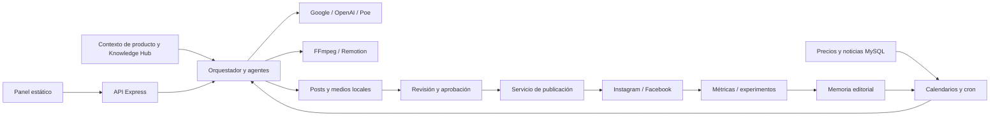

# Mapa verificado del proyecto

Exploración: 7 de noviembre de 2026. Encargo: [ONBOARD-001](tasks/TASK-ONBOARD-001.md).
Objetivo: conocer la aplicación antes de definir una nueva implementación.
Este documento describe código inspeccionado; no certifica operación en producción.

## Producto y arquitectura

IA Content Hub crea y gestiona contenido para Helpmeagro: posts, carruseles,
flyers, reels, audio reels, noticias agrícolas y stories de precios.
Combina contexto de producto, activos de marca, generación con IA, revisión,
montaje multimedia, aprobación y publicación en Instagram/Facebook.

| Capa | Implementación actual | Puntos de entrada |
| --- | --- | --- |
| Panel | HTML/CSS/JavaScript estático, sin build frontend | `frontend/index.html`, `frontend/js/app.js` |
| API | Node.js, CommonJS, Express 4 | `backend/server.js`, `backend/routes/instagram.js` |
| Agentes de contenido | Orquestador y roles cargados desde skills locales | `backend/core/AgentOrchestrator.js`, `backend/agents/Agent.js`, `backend/core/SkillLoader.js` |
| Generación | Servicios Google, OpenAI y Poe; selección dependiente del recorrido | `backend/services/geminiService.js`, `openaiService.js`, `poeService.js` |
| Vídeo | FFmpeg y Remotion 4.0.454 con React 18 | `backend/services/videoService.js`, `video-engine/src/Root.tsx` |
| Operación editorial | Calendarios, cron, correo, publicación y métricas | `backend/automation/`, servicios de estado/publicación/experimentos |
| Datos agro | Consultas MySQL externas de precios y noticias | `backend/services/agroDataService.js` |
| Persistencia propia | JSON local y archivos multimedia; trabajos activos en memoria | Servicios de posts, estado, contexto y conocimiento; `backend/output/` |

Los agentes de desarrollo dirigidos desde este chat son distintos de los agentes
de contenido que ejecuta la aplicación. `SkillLoader` lee `.agents/skills` para
estos últimos; `instagramSkillsService` incorpora 13 referencias editoriales
vendorizadas y preserva los contratos JSON de los agentes.

El diagrama representa conexiones previstas en el código, sujetas a los fallos
identificados abajo; no acredita un ciclo completo ejecutado.

## Recorridos que condicionan una implementación

- **Generación manual:** `startSwarm` envía briefing, formato, proporción,
  motor, proveedor de imagen y referencias a `POST /api/create`; recibe
  `projectId`, consulta estado cada tres segundos y muestra el resultado.
  Express llama `runFullWorkflow`, guarda el post y finaliza el estado en memoria.
  Audio reel usa una ruta multipart y `runAudioReelWorkflow` propios.
- **Marca y conocimiento:** `productContextService` inyecta el contexto de marca;
  `knowledgeService` reúne activos y resúmenes de URLs. Se guardan en JSON local.
- **Automatización:** conviven planificadores mensual y semanal y comprobación
  periódica de entradas vencidas. Hay recorridos creativos y agro distintos.
  Generación, aprobación inmediata y aprobación para fecha programada son pasos
  separados en el código; el último contiene un fallo contractual confirmado.
- **Publicación y medición:** el servicio de publicación adapta medios a cada
  red; posts conservan resultados e identificadores por plataforma. Las rutas
  de métricas permiten sincronización remota e importación manual. Experimentos
  calculan SRR (`saved / reach * 100`) y distinguen ausencia de métricas de cero.
- **Persistencia:** los archivos JSON y los mapas/candados en memoria condicionan
  concurrencia, reinicios y recuperación. Una futura cola o despliegue con varias
  instancias debe revisar estos contratos.

## Discrepancias y riesgos observados

Hallazgos estáticos; no se han corregido en este encargo.

| Evidencia | Consecuencia para la siguiente tarea |
| --- | --- |
| `PROJECT_OVERVIEW.md` describe React/Vite, pero `frontend/index.html:417` solo carga `js/app.js` | Diseñar cambios sobre el panel estático real |
| README anuncia `/instagram.html`, archivo ausente en el inventario actual | No asumir que esa pantalla existe porque la documentación la mencione |
| `frontend/index.html:132,160` llama funciones de modales sin definición en el único script cargado | Los controles de revisión de caption y métricas necesitan conexión funcional |
| `frontend/js/app.js:1171` envía `instagramSkill`, pero `backend/server.js:586,606` no lo transmite al orquestador | La selección manual no gobierna ese recorrido; sí existe inyección editorial automática por rol/formato |
| `frontend/js/app.js:1` fija `http://localhost:3001/api` | Revisar origen y configuración si se cambia el despliegue |
| `frontend/js/app.js:1183` solo termina polling con `completed` o `failed`; servidor puede devolver `timeout` (`server.js:603`) | Un trabajo agotado puede dejar la interfaz esperando |
| `scheduler.js:351-352` usa `claimApprovalPublish` y `allowed`; el servicio define `tryClaimApprovalPublish` y devuelve `claimed` (`botStateService.js:293-314`) | La publicación diferida falla antes de entrar en su bloque de gestión de errores; confirmado por QA independiente |
| Planificación semanal y mensual comparten `state.schedule`; las comprobaciones se basan en día del mes | Revisar conservación de pendientes y fronteras de mes al modificar calendario |
| `scheduler.js:639` no comprueba autopiloto activo, a diferencia de la planificación mensual | El cron semanal puede realizar planificación con consumo aunque el autopiloto esté apagado |
| `AgentOrchestrator.js:71` calcula proveedor de vídeo, pero las llamadas al editor de escenas (`:507,531`) no lo transmiten | El selector global no garantiza vídeo Poe en este recorrido; se conserva el fallback a Google del agente |
| El orquestador captura errores de montaje sin relanzarlos (`:629,809-815`) | Una promesa resuelta y un estado `completed` no prueban que exista vídeo final |
| `server.js:1174-1181` usa `Accept` para distinguir la vista HTML de la aprobación mediante GET | La protección contra prefetch no equivale a exigir POST para toda aprobación con efectos |
| Sin middleware general de autenticación observado en `server.js`; tokens específicos en webhooks | Comprobar exposición y acceso al definir un despliegue; no se verificó cómo está publicado el panel |

Además, el recorrido diferido conserva lógica de persistencia de resultados
distinta de `applyPublishResult`: `scheduler.js:406,416` puede fechar o completar
con éxito de una sola plataforma. Debe revisarse junto al contrato de claim si
la siguiente implementación afecta a publicación parcial o reintentos.

Las rutinas agro protegidas pueden superar límites del presupuesto de feed;
no se deben presentar los cupos predeterminados como límites universales.
El plan semanal actual pide 3–4 creatividades y usa memoria/tendencias, frente
a las 2–3 piezas descritas en D-019. Son comportamientos del código leído,
sin planificación ni generación ejecutadas en esta sesión.

Los estados `done` y las cifras históricas del backlog son registros de entregas
anteriores. Esta exploración no los convierte en garantías del estado operativo.
La decisión D-019 registra un problema de token Meta observado el 5 de noviembre;
no se ha consultado la cuenta ni comprobado su vigencia en este encargo.

## Herramientas y validación de esta sesión

- Skill de dirección y skills ECC `codebase-onboarding`, `agentic-engineering`,
  especialidad backend y revisión; instalación ECC 2.2.3 disponible.
- MCP Codebase Memory conectado. Proyecto usado:
  `C-Users-luis_-OneDrive-Escritorio-Creador-de-contenido-con-IA`, cuya raíz
  coincide con este workspace.
- Índice consultado: estado `ready`, 1.058 nodos y 1.971 relaciones. Se usaron
  arquitectura, búsqueda y trazado, contrastando resultados con archivos reales;
  el grafo no recoge necesariamente todas las rutas dinámicas de Express.
- Especialistas reales de arquitectura y automatización, más QA independiente.
  Lecturas locales mediante PowerShell; el entorno aislado falló con MXC y las
  operaciones autorizadas fuera de él permitieron continuar.
- `node --test tests/instagram.test.js`, desde `backend`: **7 aprobadas, 0 fallidas**.
  Prueban referencias editoriales, captions, contratos y rutas con proveedores
  simulados, sin sockets, cron ni consumo de API.
- QA ejecutó `node --check frontend/js/app.js` y `node --check backend/server.js`:
  sintaxis válida. Esto no comprueba eventos de interfaz ni lógica de negocio.
- No se ejecutó `npm test`: algunas pruebas escriben JSON de datos reales y
  `poe_pilot.test.js` consulta el catálogo remoto. La suite completa requiere una
  copia aislada y control explícito de red/datos antes de usarla como baseline.
- No se inició servidor, cron, generación, envío de correo ni publicación.
  No se leyeron secretos ni registros privados; no se probó interfaz en navegador
  ni conectividad real de proveedores, MySQL o Meta.

## Preparación para el siguiente encargo

La arquitectura y sus puntos de cambio están localizados. Al recibir la
implementación deseada se definirá el recorrido afectado, los contratos y
criterios de aceptación, preservando cambios locales. Los hallazgos de este
documento orientan ese alcance; no autorizan una corrección masiva automática.
